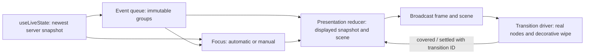

# Broadcast redesign: implementation handoff

Status: implemented on `broadcast-redesign`; validation notes below. Originally prepared
on 2026-10-28 against `bfbc47c`
on `design-upgrades`, after the league workspace redesign. This document is the
implementation brief for the next coding session. Read `frontend/AGENTS.md` and
`docs/frontend-architecture.md` first. Follow any newer repository instructions.

User clarification: the large central names/scores flying into place are a signature
part of the premium broadcast experience. Preserve that choreography. The revision
below replaces its fragile implementation, not its visual ambition. A simple wipe
and small fade are not an acceptable substitute for the normal automatic reveal.

## 1. Outcome and scope

Build a composed, modern sports broadcast with the app's plum identity, a clear
score hierarchy, readable squads and deliberate motion. It should feel like the
live presentation of this product, with more cinematic pacing and stronger
numerical emphasis than the league workspace. Keep the football pitch where space
supports it; use a purpose-built roster composition on phones.

The central architectural decision is to **keep the cinematic flight, remove the
copies**. The actual names and score appear large at center stage, hold briefly,
then travel and shrink into their final positions. Use inverse transforms on the
same DOM elements already occupying their final CSS layout. Measure that layout;
never predict a destination or swap an animated duplicate for a hidden original.
Section 5 specifies the implementation rather than leaving the mechanism to guesswork.

The central responsive requirement is that **both complete H2H squads are visible
together**, including 11 starters and four bench players per club, at the supported
phone sizes below. Switching between home and away, hiding the bench, clipping
players or adding a squad scroller does not satisfy this requirement.

Cover H2H and total-points broadcasts, automatic and manual focus, both leaderboard
scenes, player events, score updates, commentary, player dialogs and the embedded
homepage demonstration. Preserve Draft/Classic backend facts and access controls.
Do not redesign the public page around the demo, league workspace, administration,
pricing, billing or backend scoring. No new animation/UI dependency is needed.

## 2. What was examined

Reviewed the broadcast renderers, transport, focus, queue, playback reducer,
measurement and notification hooks, CSS imports, shared player styles, public demo,
existing unit/browser tests and backend standing projections. Rendered both scene
types in the local running app at six sizes using deterministic fixtures, captured
screenshots and measured player boxes after the initial reveal.

The fixtures use placeholder shirts. Their total-points variant is currently made
by removing matchups from an H2H fixture; its standing totals are not authoritative
total-points examples. Do not infer a production scoring bug from those screenshots.
This was a layout/source audit, not an exhaustive real-stream or real-device test.

| Viewport    | H2H document height | Player boxes fully inside viewport, of 30 | Total-points document height |
| ----------- | ------------------: | ----------------------------------------: | ---------------------------: |
| 390 × 844   |            1,307 px |                                        18 |                       881 px |
| 360 × 640   |            1,307 px |                                        12 |                       871 px |
| 844 × 390   |            1,351 px |                                         2 |                       864 px |
| 820 × 1180  |            1,180 px |                                        30 |                     1,180 px |
| 1920 × 1080 |            1,080 px |                                        30 |                     1,080 px |
| 3840 × 2160 |            2,160 px |                                        30 |                     2,160 px |

These counts check bounding boxes, not freedom from overlap. Each H2H screen
mounts 60 player controls: 30 for the pitch/benches and 30 for the CSS-hidden
compact rendering. The hidden instances still own notification hooks. Phone H2H
names are 10 px; total-points names are 8 px on phone/tablet. TV player names stay
at 12 px despite the much larger canvas.

### Findings and required responses

| Finding                                                                         | Evidence/owner                                                                                                                                                     | Response                                                                                                           |
| ------------------------------------------------------------------------------- | ------------------------------------------------------------------------------------------------------------------------------------------------------------------ | ------------------------------------------------------------------------------------------------------------------ |
| Headings and scores are hidden while overlay copies attempt to match them.      | `BroadcastReveals.tsx`, `useBroadcastMeasurement.ts`, `broadcast.ts`; canvas/Range measurements, copied computed styles, coordinate corrections.                   | Delete this rendering mechanism, its geometry types and correction constants.                                      |
| Motion timing has several independent owners.                                   | 1,600 ms wipe, 800 ms swap, 1,900 ms reveal in presentation; matching CSS durations; separate timers/geometry in `WelcomeBroadcastDemo`.                           | One cancellable transition lifecycle; same implementation for the demo.                                            |
| Main visual background competes with information.                               | Broad saturated green diagonal across plum, white diagonal rules, bright green ordinary point badges.                                                              | Dark plum canvas, contained muted pitch, neutral ordinary scores, accents reserved for meaning.                    |
| Compact H2H is a long zigzag of shirts.                                         | 78 px player boxes with negative margins, 15 entries in each column.                                                                                               | Aligned compact rows, explicit height budget, no negative-margin packing.                                          |
| Broadcast CSS crosses feature boundaries.                                       | `.compact-player-*` rules and their reduced-motion rule are in `administration.css`; shared player rules shrink text at 900 px.                                    | Move broadcast rules under broadcast ownership; preserve league/admin styles.                                      |
| Content fitting is brittle.                                                     | H2H names can be shrunk by canvas measurement to 8 px; total-points score is positioned beside a measured heading; fixed player widths and estimated event widths. | Grid tracks, readable type floors, bounded text, reserved event space.                                             |
| Notifications alter player geometry and use approximate collision calculations. | `playerLayout.ts` estimates text width and shifts neighboring notifications; position maps use player ID without manager identity.                                 | Keep cards stationary; put event details in a dedicated rail; identify player instances by manager plus player ID. |
| Live/error states are misleading or incomplete.                                 | Both scenes hard-code “Live”; `BroadcastPage` shows transport errors only before data exists; empty state can look like endless loading.                           | Persistent truthful connection/status treatment and deliberate empty/error views.                                  |
| Motion accessibility is incomplete.                                             | Most broadcast CSS and JS animation lacks reduced-motion handling; standings reorder via WAAPI regardless of preference.                                           | Apply one motion policy to transitions, counts, rows and events.                                                   |
| Leaderboards silently stop at 12 rows.                                          | `standings.slice(0, 12)` in `BroadcastStandings.tsx`; metrics have weak labeling.                                                                                  | Explicit score labels and access to all standings; bounded scrolling is acceptable here.                           |
| Player dialog context is lost on the live route.                                | `BroadcastMatchday` accepts `leagueId`, but `BroadcastPage` does not pass it.                                                                                      | Forward league context and regression-test the request; preserve the existing dialog.                              |
| Browser coverage misses the important layout failures.                          | `broadcast.spec.ts` checks horizontal overflow and completion, not all-player visibility, occlusion or text size.                                                  | Add geometric and interaction assertions plus visual review of intermediate frames.                                |

Keep the useful separation already present: live transport, immutable queued
snapshots, focus decisions, presentation state and scene components. This is an
evolution of that architecture, not a new application framework.

## 3. Visual specification

Use broadcast-scoped tokens under a dedicated root such as `.broadcast-view`.
The existing `.broadcast-shell` is a shared layout primitive used elsewhere; do not
globally repurpose it into a fullscreen stage. Public and league palettes are the
reference, but the broadcast can be darker and less card-heavy.

| Role                                   | Starting value/treatment                                                   |
| -------------------------------------- | -------------------------------------------------------------------------- |
| Canvas                                 | `#120d19`, near-black with a plum cast                                     |
| Main surface                           | `#201626`                                                                  |
| Raised control/dialog-adjacent surface | `#2b1d33`                                                                  |
| Brand plum                             | `#37003c`, used for a restrained gradient or wipe                          |
| Primary text                           | `#faf7fc`                                                                  |
| Secondary text                         | `#c4b7cd`                                                                  |
| Active selection / broadcast accent    | App cyan `#20e6ff`                                                         |
| Positive scoring / leading             | App green `#00ff85`, restrained tint plus explicit text/sign               |
| Negative correction                    | `#ff6b85`, explicit minus sign                                             |
| Pitch                                  | Muted dark green around `#112c28`; low-contrast markings                   |
| Rules                                  | White at roughly 10–14%; stronger focus/control boundaries where necessary |

These are design starting values, not a contrast certification. Verify rendered
text and controls on their actual backgrounds. Team colors are small identity
stripes/dots; they must not determine text contrast or replace outcome semantics.

Use the existing sans-serif stack. Scores use tabular numerals, weight 750–800,
stable allocated widths and no heavy shadows. Normal names use 600–650 and
metadata 400–500. Avoid all-uppercase body text. Keep geometry mostly rectangular,
with 4–8 px radii for controls/panels, consistent with the app. No glass-effect
dashboard, permanently oversized decorative headings, moving background or new
font dependency. The temporary large central introduction is an intentional exception:
it is the broadcast's signature moment, not ordinary page chrome.

Starting settled-layout type scale in CSS pixels (intro sizing is in section 5):

- Phone: score 36–44; club 14–16; player name 12 minimum, preferably 13–14;
  player points 13–15; commentary 12–14. Labels must remain readable.
- Laptop/desktop: score 64–88; club 24–32; player name 14–16; points 16–20;
  commentary 15–18.
- TV at 3840 × 2160: score 112–144; club 40–48; player name 24–28;
  points 28–32; commentary 26–30. Scale content as well as whitespace.

Use fluid sizes with explicit floors/ceilings. Allow club names two bounded lines;
short player labels may truncate with an ellipsis and expose full names in their
accessible label and player dialog. Do not fit text with a canvas or scale the
entire mobile scene down. Keep the existing negative-score formatting unambiguous.

## 4. Scene compositions and responsive contract

### Common frame

Compose the screen as an in-flow grid: controls, score/identity, main content,
event/commentary rail. The rail's space exists even when idle, so a goal or a long
caption does not change squad height. Back, focus selection and connection status
belong in the top row rather than independent absolute-positioned islands.

```text
┌ Back     [Auto / selected match or club]      Connection ┐
│ Home identity              53 – 49        Away identity │
│                                                        │
│                  Scene content                         │
│                                                        │
│ Event identity / change · commentary                    │
└────────────────────────────────────────────────────────┘
```

Use a viewport-height live root (`100dvh` with a suitable `svh` fallback), safe-area
padding, `minmax(0, 1fr)` and `min-height: 0` on flexible tracks. Do not “fix”
overflow by clipping essential contents. The embedded demo fills its own container;
its transition layer is absolute within that container, never viewport-fixed.

Use clear layout modes, initially:

- Wide stage: available width at least about 1100 px and height at least 650 px.
- Compact portrait/tablet: narrower/taller containers; use readable rosters where
  a pitch would make player labels overlap.
- Short landscape: available height below about 540 px with sufficient width;
  use the multi-column roster described below.

Treat these as content thresholds to validate, not device detection. Base the
embedded demo on its container. Prefer CSS layout/container queries; use one small
size observer only where JS genuinely needs the selected mode. Do not scatter
`window.innerWidth` and unrelated `matchMedia` calls through player renderers.

### H2H wide stage

Preserve the characteristic opposing formations on a horizontal football pitch,
with home/away identity above, a centered score and bench rails at the outer edges.
The pitch is the main visual object, with a subtle halfway line and penalty areas.
Give players sufficient cells so every formation supported by the data fits.
Use grid-based position groups or bounded formation coordinates within the pitch;
avoid mixing viewport percentages with arbitrary pixel offsets.

Keep score and clubs on one deliberate header band. Leading is a small marker by
the club, with a reserved slot; level scores say “Level”. Team names do not span
into the central score. Reserve event space below the pitch, not on top of it.
Use the roster mode at short laptop heights if this composition cannot fit cleanly.

### H2H phone portrait: the full-squad requirement

Use two equal-width club columns. Each has 11 aligned starter rows followed by a
small bench divider and four bench rows. A row is a whole-player button containing
an optional small shirt, short name, status marker where supplied and right-aligned
points. Do not alternate rows left/right. The entire button remains inside its
club's half. All 30 player instances must be visible simultaneously.

```text
┌ Back     [Auto · match picker]       status ┐
│ Home club          53–49         Away club │
│ Manager             GW24          Manager │
│ Saka           8   │ Saka                3 │
│ Watkins        4   │ Watkins             4 │
│ … 9 other starters │ … 9 other starters    │
│ Bench              │ Bench                │
│ Pickford       1   │ Pickford            1 │
│ … 3 other reserves │ … 3 other reserves    │
│ Home · Saka · Goal +5                      │
│ Commentary excerpt…        [full text]     │
└───────────────────────────────────────────┘
```

Required normal-text acceptance sizes: 360 × 640, 375 × 667, 390 × 844 and
430 × 932 CSS pixels. Both squads, identities, score, essential controls and the
bounded rail fit without document or squad scrolling, with idle and active events.

Example budget at 360 × 640: allow 32 px for combined safe-area/outer spacing,
44 for controls, 72 for identity/score, 24 for inter-section gaps, 60 for the
event/commentary rail and 18 for the bench divider. This leaves 390 px for 15 rows,
or 26 px each. This is a design budget to prove in the browser, not a set of
independent hard-coded heights. At 390 × 844, spend extra height on approximately
34–38 px rows and more breathing room. Keep compact player targets at least 24 px
high with no overlap; primary controls around 44 px.

Remove decorative shirts before reducing text or hiding players. Never force 15
rows of 44 px targets plus all chrome into a 640 px screen: that budget cannot fit.
On 320 px width, larger text/zoom, unusually large safe areas or heights below the
supported envelope, preserve readable content and allow vertical scrolling. Do
not claim a universal no-scroll guarantee or disable browser zoom. Expanded
commentary and player dialogs can scroll within their own viewport-bounded dialog.

### Short landscape

At 844 × 390, keep both clubs side by side but arrange each club's 15 entries into
three columns of five compact rows. Mark each bench entry explicitly; do not insert
a tall independent bench section. Keep row-major reading/focus order deliberate.
An initial budget is 40 px controls + 52 score/identity + 200 players (5 × 40) +
52 rail + 24 padding/gaps = 368 px. Validate safe areas and all 30 entries.

At still shorter sizes (including 667 × 375), try the same composition, remove
nonessential metadata/shirts first, then permit the documented readable fallback
if needed. Never reuse the tall portrait roster unchanged in landscape.

### Total-points scene

Use the same frame, controls, type, player component and motion vocabulary. Wide
layout: approximately two-thirds squad area and one-third standings, with the
club/manager and a clearly labeled “Gameweek points” score above the squad. Group
players by position in a measured CSS grid, bench clearly separated. No score
absolutely positioned outside the team heading; no negative viewport-height offsets.

Compact layout: one full-width readable squad list (or the short-landscape grid),
with a “Standings” control opening the standings scene. A sidebar must not simply
disappear with no manual route to its information. Target the same full-squad fit
for this 15-player screen. Do not retain 8 px formation labels on phones.

### Leaderboards

Use a proper labeled table or equivalent semantic structure, restrained separators,
tabular values and a subtle focused-club stripe. Use real headings, not a `strong`
element masquerading as a heading through a ref type.

- H2H: distinguish league points (`total`) from gameweek fantasy points
  (`gameweekPoints`); `pointsFor` is cumulative fantasy points. Prioritize league
  points and GW points on narrow screens. Do not label one as another.
- Total-points: label GW points and season total explicitly. A positive gameweek
  total is not an event delta; remove the unconditional plus sign for that column.
- Retain backend ordering. Keep all entries reachable in a bounded table scroller
  with a sticky header; this screen is exempt from the no-squad-scroll requirement.
  No unexplained top-12 truncation. Keep the focused row visible when appropriate.
- Animate reordering of existing keyed rows only. A small FLIP translation on the
  actual row is acceptable; text-copy overlays are not. Cancel previous animations
  before retargeting. Skip movement for reduced motion or ordinary resizing.

## 5. Playback and motion architecture

### Keep the existing ownership boundaries



Retain `useLiveState`, `useBroadcastEventQueue`, `useBroadcastFocus`,
`broadcastPlayback.ts`, `useBroadcastPresentation` and `usePlayerNotification`
where they own real responsibilities. Refactor their interfaces only as needed.
Avoid a new global store, generic timeline engine or a second event queue.

Use an explicit scene identity such as H2H + matchup ID, total-points + manager ID,
or leaderboard + scoring mode. Render from the **displayed** identity/snapshot.
Currently scene selection can mix target, manual and displayed choices in
`BroadcastPage`; a future target must not bypass the scene transition transaction.

Replace overlapping visual booleans with a small phase union (`idle`, `covering`,
`preparing`, `introducing`, `landing`) plus current/target snapshot and an incrementing
transition ID. `preparing` means the incoming DOM is committed under the cover but
its inverse transforms have not yet been installed. Keep
event visibility separate from decorative motion. A completion for an obsolete ID
must have no effect. Expose a small presentation contract to the renderers, not six
heading refs and several geometry objects.

Suggested small additions, only where the responsibilities warrant them:

- `BroadcastFrame.tsx`: common controls, status, scene slot and reserved rail.
- `BroadcastTransition.tsx` / `useSceneTransition.ts`: one animation lifecycle.
- `broadcastRevealGeometry.ts`: a pure rectangle-to-transform calculation, with no
  DOM reads or data selection; local element refs and DOM reads stay in the driver.
- `BroadcastSquad.tsx`: shared squad/player composition with responsive CSS.
- `BroadcastEventRail.tsx`: bounded event details and commentary presentation.
- One small shared motion-preference hook if the existing dialog behavior can
  benefit from it; do not rewrite unrelated dialogs to justify the abstraction.

### Signature reveal: same elements, inverse transforms

This is the required normal-motion effect, including the initial broadcast entry:

1. An opaque plum wipe covers the outgoing scene. Initial entry starts covered.
2. The incoming club names and score appear large and composed at center stage,
   on a quiet plum backdrop. They hold long enough to read.
3. Those exact elements shrink and travel to their real header positions while the
   pitch/squad is unveiled. The landing is smooth and decelerated, without bounce.
4. Once the landing finishes, normal event/count presentation begins. There is no
   last-frame crossfade between two versions of the text.

H2H has three flying elements: home club, scoreline, away club. Total-points has
two: club and score (keep its `pts` unit inside the same score element). A leaderboard
has one: its real heading. Manager metadata, shirts and rows may fade in beneath
them; they do not all fly across the screen.

#### A. DOM and layer contract

Keep each flying element in its **final layout cell for the entire reveal**. Put
the text inside an intrinsic-size motion wrapper (`inline-block` or `width:
fit-content`, bounded by the cell) with `transform-origin: 50% 50%`. The wrapper is
the animated node. Reserve its normal layout space even while transformed. Use
stable keys within the scene; phase changes must never replace the wrapper or its
text node. Do not reparent into a portal, call `cloneNode`, render a second heading,
or use a screenshot/text snapshot. Replacing the old scene at the covered commit
is fine; replacing incoming nodes during their flight is not.

Keep final font size, line-height, width, wrapping and alignment unchanged throughout
the flight. Scale the wrapper uniformly. A two-line final club name stays two-line
in the introduction. Do not animate `font-size`, width, top/left or letter spacing,
and do not measure canvas glyphs or copy computed typography. The source may look
larger; its text layout must be the same one that will land.

Inside an isolated, positioned scene root, use this explicit stacking order:

- Normal pitch/roster and ordinary metadata: base layer.
- Intro backdrop: layer 10, visually covers normal content during the central hold.
- Actual flying text wrappers: positioned layer 20 during the reveal.
- Opaque outgoing/incoming wipe: layer 30, covers everything during scene commit.
- Persistent controls: outside the scene root or above layer 30; native dialogs
  remain in the browser's top layer.

Do not put the wrappers inside an ancestor with opacity, transform, filter,
`contain: paint`, clipping or a lower isolated stacking context that traps them
under the intro backdrop. Fade non-flying siblings individually, not their shared
parent. All intermediate ancestors must allow the transformed text to overflow;
only the outer scene bounds clip the transition. Test the actual layer arrangement,
not merely the numeric z-index. The backdrop and empty layout anchors are decorative,
`aria-hidden` and non-interactive. Actual names/scores remain the semantic content.

#### B. Define the introduction with empty CSS slots

Add an absolute, non-interactive intro-layout grid inside the scene root. It contains
empty home/score/away slots, **no text copies**. Its only purpose is to define safe
source rectangles using CSS. Keep it laid out while measuring (`visibility: hidden`
is fine; `display: none` is not). Exclude controls, safe areas and the bottom rail.

- Wide H2H: home / score / away on one centered row, with explicit gaps and generous
  outside margins. Use roughly 35% / 30% / 35% of usable width, accounting for gaps.
- Portrait H2H: three centered, vertically separated slots: home, score, away.
  Allocate about the middle 55% of usable stage height; do not force long names
  into side-by-side oversized intro columns on a phone.
- Total-points: club / score side by side when space permits, stacked otherwise.
- Leaderboard: one centered slot.

All slots must fit the usable scene bounds and remain mutually disjoint. Normal
intro targets: club names around 64–88 px and score 112–152 px on desktop; club
names 28–36 px and score 64–88 px on phones; roughly twice the desktop values on
the 4K canvas. These are preferred apparent sizes, bounded by each slot's measured
space. Long names use a smaller uniform scale without changing their line breaks.
Short names should visibly grow; do not quietly clamp every reveal to scale 1.

#### C. Measure once, calculate the inverse transform

After the covered React commit, read each wrapper's **untransformed** final border
box `D` and its empty source slot `S` with `getBoundingClientRect()`. Batch all reads
before writing any animations. Cancel previous effects before measuring; never
measure a partially transformed wrapper and treat it as the final destination.

The scene and its ancestors must use unscaled, unrotated CSS coordinates. Replace
the demo's existing 200%-size/0.5-scale wrapper and rotated content surface with an
actually sized responsive demo container. Preserve its placement/aspect ratio in
the homepage; any decorative tilt can be applied to a separate background. Do not
build a special DOMMatrix/offset walker to compensate for a transformed demo.
With this constraint, viewport-relative rectangle differences equal CSS translations
even when the embedded demo is offset or the page is scrolled.

For center origins, the calculation is:

```ts
// Pure geometry. D and S use the same CSS-pixel coordinate space.
const dx = S.left + S.width / 2 - (D.left + D.width / 2);
const dy = S.top + S.height / 2 - (D.top + D.height / 2);
const scale = Math.min(preferredScale, S.width / D.width, S.height / D.height);
const from = `translate(${dx}px, ${dy}px) scale(${scale})`;
const to = "translate(0px, 0px) scale(1)";
```

`preferredScale` is the target apparent font size divided by the final font size,
not a guessed text width. Use the same fitted name scale on both H2H sides if needed
for visual balance. Validate positive finite rectangles and scale. Invalid/zero-size
geometry settles directly to a readable static scene; it must not leave text hidden.
No Y corrections, per-name offsets, viewport percentage destination guesses or
independent X/Y stretching are allowed. The final layout itself is the destination.

#### D. Prepare under cover, then play the actual elements

Implement one small transaction in `useSceneTransition`; keep its geometry helper
pure and playback/queue decisions elsewhere. Use the following order:

1. Create a new transaction ID; finish the cover animation and dispatch `covered(id)`.
   The reducer commits the captured incoming snapshot and enters `preparing`.
   Initial entry renders the cover in its very first committed frame; do not add
   it in a later passive effect after the final-layout text has already flashed.
2. A layout effect for that committed ID collects local refs, validates the scene
   and measures `D`/`S`. It must not depend on every subsequent live-state update.
   Install the inverse transforms through paused WAAPI animations with `currentTime
= 0` and `fill: 'both'` before the cover can reveal the new scene.
3. Enter `introducing`: uncover over 220 ms. The real text is already at its source
   position above the intro backdrop. Hold the source pose for another 360 ms.
4. Enter `landing`: play the text animations together for 780 ms. Reveal the squad
   by fading the intro backdrop over the first 450 ms. Use a restrained decelerating
   curve such as `cubic-bezier(0.22, 1, 0.36, 1)`; no elastic overshoot.
   Do not fade the text itself to hide an inaccurate landing. Freeze its strings
   and score values through the flight; newer snapshots stay in the existing queue.
5. Await all text landings. For the still-current transaction, cancel their identity
   fill effects and remove temporary layer/`will-change` styles. CSS already owns
   the same final positions, so cleanup causes no movement. Dispatch `settled(id)`
   and open the presentation gate exactly once.

Use named timing constants in one module. The 360 ms hold can be part of a tracked
WAAPI sequence or one owned, cancellable delay; it must not be a second independent
clock guessing when landing ends. Data gates follow real phase completions, using
`Animation.finished`. Handle cancellation rejections on every tracked animation.
Register animations before starting/awaiting them. Check transaction ID and mounted
state after every await. A watchdog is failure recovery only, never normal timing.
Do not persist the inverse pose with `commitStyles()`.

React Strict Mode effect setup/cleanup/setup must work: cleanup invalidates its
local run and cancels its own resources; the next setup may start the valid reducer
transaction again. Do not use a permanent “already ran” ref that suppresses the
second setup and leaves the wipe stuck. Driver phase bookkeeping must not cause
its own preparation effect to recreate the animations on every phase update.

#### E. Direct text flight on portrait layouts

Use the same direct flight on portrait and wide layouts. The user accepts temporary
text overlap during travel; do not add a sideways detour or collision offsets:

```ts
[{ transform: from }, { transform: to }];
```

All text elements share timing and easing. Preserve the measured source slots and
final header positions. Endpoint boxes remain separated and inside the scene;
overlap while flying from stacked portrait slots to the header is intentional.

#### F. Timing and migration contract

| Action                               | Motion                                                                                                               |
| ------------------------------------ | -------------------------------------------------------------------------------------------------------------------- |
| Initial scene                        | Begin covered, prepare real text, uncover 220 ms, central hold 360 ms, land 780 ms; about 1,360 ms after preparation |
| Automatic focus / leaderboard change | Cover 220 ms, covered commit/preparation, then the same introduction and landing; about 1,580 ms plus preparation    |
| Manual focus or standings selection  | Immediate selection plus 120–160 ms in-place entrance; rapid navigation must not force a full intro                  |
| Player event                         | 160–200 ms emphasis, hold for event lifetime, 140–180 ms fade                                                        |
| Score count                          | Bounded 300–450 ms after landing opens the presentation gate                                                         |
| Standings reorder                    | Approximately 320–420 ms on the actual rows                                                                          |

Do not shorten the automatic reveal into a 500 ms wipe-only change. Tune the stated
timings after reviewing recordings, retaining the visible central hold and flight.
The full-squad fit requirement applies to settled/event-active scenes; temporary
occlusion by the intentional introduction is allowed. Automatic data-only updates
to an unchanged scene must not restart this ceremony.

Remove the old `BroadcastReveals.tsx`, `useBroadcastMeasurement.ts`, `RevealRect`,
`RevealLayout`, copy-fitting helpers and correction CSS after all callers migrate.
Replace them with the focused local measurement/transform code above; do not simply
delete all measurement. New refs belong to the scene transition driver, not the
queue or playback reducer. The homepage demo uses the same driver and slot layouts.
Do not substitute View Transition screenshots for these actual-node flights.

### Interruption rules

- Automatic changes are serialized. Keep the current frozen target through its
  transition; leave subsequent event groups in the existing queue. Cosmetic idle
  rotation may coalesce to its latest requested scene.
- Manual selection wins immediately, including during a wipe: cancel animations,
  invalidate the transition ID, remove the cover, commit the selected scene and
  suspend automatic focus as today. Do not clear pending events merely to simplify
  navigation; preserve their queue semantics and filter presentation to that scene.
- Resize/orientation change never restarts the intro or replays scoring. Layout
  changes in place. Observe the root, untransformed layout cells and font readiness
  (not animated wrapper bounding boxes). On a material size/font change during
  flight, cancel the old transforms and settle the valid target in normal layout;
  do not chase its new position frame by frame. This is a deliberate recovery path,
  not the normal transition. Use stable fonts at preparation; do not await font
  loading indefinitely behind an opaque cover. Later font completion settles the
  active reveal once, or simply reflows an idle scene.
- Reduced motion skips the wipe, translations, FLIP movement and incremental
  counting. Commit correct values and event labels immediately. Never retain a
  2.7-second invisible wait after turning CSS animations off.
- On tab visibility return, settle stale decorative animation to a consistent
  committed state. Do not replay missed wipes or narrations in a burst.
- On user/league change or unmount, cancel animations, callbacks, observers and
  timers; preserve the existing transport/audio cleanup and session isolation.

Implement one idempotent cleanup/settle path: invalidate the local run first,
cancel every registered animation/delay, remove all temporary transforms/visibility,
backdrop and layer overrides, then commit the appropriate valid snapshot if still
mounted. Explicit manual selection supplies the requested scene; resize/reduced
motion settles the current transaction target; unmount performs cleanup only.
A canceled animation's promise must never publish `settled` for an obsolete scene.

## 6. Player events, data consistency and sound

Render one player instance per `(managerId, playerId)` in the active scene. Classic
teams can contain the same footballer on both sides; notification identity must
include the manager. Prefer one DOM tree adapted by CSS. If substantially different
compositions require conditional rendering, mount only the active composition and
keep notification presentation state above the layout switch so resizing cannot
recount points. Never keep both notification trees mounted behind `display: none`.

Player buttons use native `button` semantics, full accessible names and visible
focus. Preserve supplied substitutions, status, minutes and the existing no-minutes
zero-points display convention; do not invent captain/chip metadata absent from
the contract. Use a consistent shirt fallback without layout change on image error.
Pass `leagueId` and current gameweek through to the shared player details dialog.

For active events, keep player cards/rows stationary. Apply a restrained outline or
background tint and show the signed delta in an allocated slot. Put full event
labels in the rail: club identity, player, event, signed points. Several affected
players may highlight at once; detailed labels use a bounded list/carousel with a
visible count and access to the full group. No stacked absolute event banners
growing into neighboring names. Remove obsolete collision-shift calculations.

The rail allocates an event line and a bounded commentary excerpt. Long commentary
has a keyboard/touch-accessible full-text dialog or panel; never let it expand over
the squad. “AI-generated commentary” remains explicit. Empty/waiting commentary
does not repeatedly announce itself. Use one polite event announcement per group,
not a live region per changing player number. Captions must correspond to the
commentary actually being presented, not a newer unrelated snapshot.

Score correctness is a release gate:

1. Keep newest server state, queued group snapshots and displayed state distinct.
2. At the scene commit, use the selected frozen snapshot consistently for club,
   team score, players, standings, selector values and event group.
3. Preserve pending-delta subtraction until the event's reveal gate opens. Aggregate
   all relevant deltas for a manager/player; handle corrections and negative totals.
4. Reuse the existing notification rule rather than reconstructing previous scores
   differently in player cards and selector chips. Bound count duration even for
   large deltas; finish exactly at the authoritative value.
5. Maintain the queue's deduplication, priority, three-pending-group limit, immutable
   active snapshot, ten-second active lifetime and voice AUTO_SUB suppression in
   this redesign. Changing reveal duration must not silently change these rules.

Audit sound while changing the visual gate: the point sound currently starts when
the queue activates, which may precede scene visibility. Trigger it once when the
corresponding visible event starts, retaining existing audio initialization and
deduplication. Keep narration transport/serialization behavior intact; coordinate
caption identity with playback if needed. Do not build a second audio queue or
assume browser autoplay permission. Hidden layout copies must never own sound.

## 7. Controls and operational states

- Wide screens may keep a bounded horizontally scrollable match/club strip. Clearly
  distinguish automatic mode from the currently displayed automatic target, and
  expose selection semantically (`aria-pressed` or the appropriate control pattern).
- Phones use a compact trigger and viewport-bounded picker with full club names,
  scores, current selection and the automatic option. Reuse the existing dialog
  motion/focus behavior. `LeagueSelect` is league-owned and numeric; do not import
  it directly into broadcasts or force string manager IDs through a numeric API.
  Extract only a genuinely reusable picker primitive if needed, preserving existing
  league picker behavior and regressions.
- Use product wording “Auto” or “Automatic” to clarify the existing `multi` behavior;
  keep the internal focus contract compatible. Provide manual standings access.
- Show connecting, connected/live, reconnecting with retained data, empty and failed
  initial load deliberately. Demo/mock mode is labeled as such. Once data exists,
  surface transport interruption instead of leaving a healthy “Live” badge.
- Use only status facts supplied by transport/backend; `updatedAt` is not proof
  that an underlying match is live or finished. Do not fabricate freshness thresholds
  or final-match status. Retry initial failures through the existing request boundary.
- Preserve a reliable Back control. Player dialogs must appear above the transition,
  fit the viewport and return focus to the player. If its node has disappeared after
  rotation, restore focus to the scene heading or focus control instead.

## 8. Implementation stages

Work in this order. Each stage must be reviewable and leave the app usable. The
following are suggested commit messages matching the repository's imperative
style; implementation was subsequently authorized. No commits were made during implementation.

### Stage 1 — Establish reliable broadcast fixtures and baselines

Suggested commit: `Add broadcast redesign regression fixtures`

- Extend `tests/browser/broadcast.spec.ts` and fixture helpers with proper H2H and
  total-points data, full squads, same-player/different-manager events, long names,
  20+ standings, substitutions, negative corrections, missing shirts and commentary.
- Use controllable SSE updates and animation progression. Preserve existing queue,
  snapshot and manual-focus tests; record current layout failures as baseline
  measurements, not unexplained permanent skips.
- Capture current representative screenshots and the score/event ordering contract.

Exit: repeatable fixtures exercise every scene; new scoring fixtures have coherent
metrics and the existing checks remain green.

### Stage 2 — Introduce the broadcast frame and visual system

Suggested commit: `Establish broadcast frame and visual hierarchy`

- Add scoped tokens, in-flow chrome, bounded content/rail slots and status UI.
- Move broadcast-only compact rules out of `administration.css`. Keep shared player
  styles unchanged where league views depend on them; override under the new root
  or move only proven broadcast-specific rules.
- Establish main layouts and truthful loading/empty/reconnect states. Keep existing
  scenes working while they migrate. Protect public/demo container sizing.

Exit: no leaked styling in leagues/admin; chrome and rail reserve their space at all
six main viewports; existing content remains reachable.

### Stage 3 — Rebuild the cinematic reveal with actual elements

Suggested commit: `Rebuild cinematic broadcast reveals without text copies`

- Refactor `broadcastPlayback.ts`, `useBroadcastPresentation` and `sceneTypes` to
  explicit scene/phase identity and guarded completion.
- First prove the section 5 mechanism on one deterministic H2H scene: stable text
  wrappers, empty source slots, measured destination boxes, inverse transforms,
  central hold and actual-node landing. Prove desktop and phone paths before
  integrating the queue. Do not create a separate shipped prototype/animation mode.
- Integrate the driver with covered scene commits and event visibility. Implement
  interruption, cleanup, invalid-geometry and reduced-motion paths. Both scoring
  types and leaderboard headings use the same mechanism.
- Migrate `WelcomeBroadcastDemo` to the same transition implementation with its
  deterministic frame driver and a correctly sized, untransformed content container.
  Delete its geometry walker and duplicated timings.
- Remove the old clone-measurement API and its dead callers/styles/types; keep the
  new focused geometry helper and local refs required for actual-node animation.

Exit: transition regression tests pass, including mid-wipe manual selection,
resize, reduced motion and unmount. No hidden originals plus flying copies remain.
Recordings clearly show large central text holding, shrinking and flying into place;
the real nodes survive all reveal phases, and canceling completed effects causes
no position change. A wipe-only or fade-only automatic reveal fails this stage.
Homepage demo transitions are contained within the demo and its outer page is intact.

### Stage 4 — Recompose H2H squads for every viewport

Suggested commit: `Redesign responsive head-to-head broadcasts`

- Implement the wide pitch, two-column portrait roster and short-landscape grid.
- Consolidate player/bench rendering so each manager/player instance mounts once.
- Replace dynamic heading sizing and zigzag packing with bounded grids and type.
- Keep the event rail reserved and player dialogs functioning with league context.

Exit: all 30 players fit at every required phone size, including active events;
no squad scrolling, overlap or sub-12 px labels; desktop formations and TV scale
reviewed. Resize does not replay active notifications.

### Stage 5 — Make event presentation stable and consistent

Suggested commit: `Unify broadcast event and score presentation`

- Move event details into the rail, add compact in-place emphasis, and remove
  obsolete notification collision/width estimates.
- Unify score-delta presentation, bounded counting and visible-event sound gating.
- Coordinate long/multiple event labels, commentary, full-text access and focus.
- Retain queue behavior and frozen-snapshot tests; extend them for simultaneous
  Classic ownership and late updates during transitions.

Exit: bursts, negative corrections and multiple events remain readable with no
layout movement, double count, duplicated sound or newer-snapshot leakage.

### Stage 6 — Redesign total-points scenes and leaderboards

Suggested commit: `Redesign total-points broadcasts and standings`

- Apply the same frame, player components and motion to the club/squad layout.
- Implement responsive standings, explicit metric labels, complete row access and
  manual standings navigation. Remove the unconditional positive-total sign.
- Animate actual ranked rows with cancellation/reduced-motion support. Preserve
  automatic leaderboard rotation and backend ranking.

Exit: both modes have the same visual quality; all 15 players are readable and fit
the supported compact envelope; all standings remain accessible; metric labels are
correct for H2H versus total-points fixtures.

### Stage 7 — Validate, simplify and document the final system

Suggested commit: `Verify broadcast motion and responsive layouts`

- Run the full checks below and review screenshots/transition recordings. Fix
  failures instead of compensating with extra CSS overrides.
- Remove temporary compatibility props/classes, dead clone-measurement code, duplicate
  timing constants and unused player-layout helpers.
- Update `docs/frontend-architecture.md` with the final scene/transition contract,
  responsive modes and intentional small-height/zoom fallback. Mark this plan's
  implemented stages with results and explain any deviations.

Exit: the acceptance matrix below is satisfied and test evidence is recorded.

## 9. Validation and completion criteria

Run Node from `frontend/.nvmrc`. For every meaningful stage, run `npm run check`;
timing/layout/workflow changes also require `npm run test:browser` against a fresh
build, per `frontend/AGENTS.md`. Keep existing league picker, player-dialog and
public workflow tests passing. Use the configured Chrome executable if the local
Playwright browser is unavailable. Do not modify working application state merely
to manufacture test data; use deterministic fixtures first.

| Area           | Required cases and assertions                                                                                                                                                                                |
| -------------- | ------------------------------------------------------------------------------------------------------------------------------------------------------------------------------------------------------------ |
| Portrait H2H   | 360×640, 375×667, 390×844, 430×932; 30 visible player instances, each full button inside usable viewport and outside chrome/rail; no document or squad scroll; no overlaps.                                  |
| Landscape      | 844×390 full-fit target; 667×375 stress/fallback; both teams, scores and controls usable.                                                                                                                    |
| Other sizes    | Existing tablet 820×1180, laptop 1366×768, desktop 1920×1080, TV 3840×2160; text visibly scales and no stranded tiny content.                                                                                |
| Layout stress  | 320 px width, 200% zoom/text enlargement, long Unicode names, missing shirts, 3-digit/negative scores, large safe-area allowance, unexpected squad sizes; readable fallback without silent clipping.         |
| Motion         | Initial, automatic, manual, leaderboards, rapid repeated selection, selection during cover/reveal, resize/orientation mid-animation, background/foreground, reduced-motion toggled during playback, unmount. |
| Data           | SSE before initial HTTP, stale HTTP, reconnect/malformed update, pending group, new snapshot during cover, multiple deltas, shared player on both teams, AUTO_SUB and corrections.                           |
| Events/audio   | Stable player geometry; score freeze then exact final values; bounded count duration; one point sound per visible group; captions align with narration; no orphaned audio/timers on exit.                    |
| Interaction    | Keyboard-only selector/standings/player details, Escape and backdrop dismissal, focus restoration, active event while dialog is open; leagueId/gameweek forwarded.                                           |
| Standings      | 20+ clubs, focused club outside original top 12, simultaneous reorder/score update, resize during reorder, correct metric headings and reduced motion.                                                       |
| Demo/isolation | Homepage demo uses same motion within its bounds; public page, leagues, administration and shared dialogs retain their layouts and behavior.                                                                 |

Use geometry assertions on visible buttons and score/name containers, not only
`document.scrollWidth`. Detect overlap with reserved chrome/rail and sample
`elementFromPoint` where overlays could intercept clicks. Capture covered, central
hold, intermediate flight, pre-cleanup landing, settled and event-active states.
A screenshot is evidence to inspect,
not an assertion that the layout is correct. Verify natural text size and truncation.

### Required reveal-specific tests

The implementation must test the mechanism, not just wait until an overlay disappears:

1. Keep references to incoming home/score/away wrappers and text nodes after the
   covered commit. Assert those exact nodes are still connected and identical at
   central hold, flight, landing and cleanup. Count one wrapper per role **inside
   the scene**; selector chips may legitimately repeat scores/names.
2. During preparation, record untransformed destination rectangles. Pause/seek the
   tracked WAAPI animations to deterministic progress, allowing the browser to paint.
   At the source pose, actual text boxes fit their source slots. At landing they
   match the recorded destination within 1 CSS px. Immediately after effects are
   canceled, their boxes still match within 1 px, without a hidden/opacity-zero
   handoff frame. Do not compare only against a newly measured destination that
   might itself have moved incorrectly.
3. Sample at least 0%, 20%, 40%, 60%, 80% and 100% of flight, plus the central hold.
   Assert text stays within scene bounds and flights are direct. Allow transient
   overlap from stacked portrait slots; keep endpoint boxes separated. Cover
   two-line names, unusually long names, negative/three-digit scores, all main layout
   modes and the embedded demo after page scrolling. Inspect a real-time recording
   as well: endpoint correctness alone does not establish a premium animation.
4. Confirm visibly enlarged central text for ordinary short-name fixtures, a real
   hold, and meaningful travel. A static final-layout heading that simply fades in
   must fail even if all geometry and cleanup assertions pass.
5. Invalidate at each phase: rapid selection, rotation/resize, font completion,
   reduced-motion toggle and unmount. Resolve old animation promises afterward;
   they must not change the newly selected scene or fire its event gate twice.
   Repeat with React Strict Mode effect replay and with invalid/zero-size geometry.
6. Unit-test the pure center-origin transform formula and slot fitting with
   translated roots (simulating embedding/scroll), multi-line boxes and unequal
   name lengths. Test that cleanup leaves no active effects or inline inverse pose.

Unit-test reducer/queue/interruption invariants. Browser-test actual animation
completion and cancellation, because fake timers alone cannot verify layout or
WAAPI behavior. Add a check that each expected manager/player pair has one mounted
interactive representation. Ensure observers, timeouts and animations are released.

Before calling the work complete, test at least one real phone/browser with browser
chrome expanded and collapsed, and real stream/audio behavior on the local stack
if available. Chromium viewport emulation cannot establish iOS safe-area, mobile
audio permission or actual TV reading-distance quality; report these as unverified
when they cannot be exercised. Keep the no-scroll acceptance envelope explicit.

## 10. Platform references

The motion driver can await actual completion using
[MDN: Animation.finished](https://developer.mozilla.org/en-US/docs/Web/API/Animation/finished).
The actual-node transforms use [MDN: Element.animate](https://developer.mozilla.org/en-US/docs/Web/API/Element/animate)
and a fixed [transform origin](https://developer.mozilla.org/en-US/docs/Web/CSS/transform-origin).
Measure source/final boxes in the same coordinate space using
[getBoundingClientRect](https://developer.mozilla.org/en-US/docs/Web/API/Element/getBoundingClientRect).
Track effects and handle rejected completion promises when calling
[Animation.cancel](https://developer.mozilla.org/en-US/docs/Web/API/Animation/cancel).
Apply the user's motion preference to both CSS and JS behavior; see
[MDN: prefers-reduced-motion](https://developer.mozilla.org/en-US/docs/Web/CSS/@media/prefers-reduced-motion).
The viewport sizing choices should account for dynamic browser UI; see
[MDN: viewport-relative length units](https://developer.mozilla.org/en-US/docs/Web/CSS/length).
These references support the platform mechanisms; the layouts, timing targets and
implementation stages above are project-specific design decisions.

## Start instruction for the implementation session

> Implement `docs/frontend-broadcast-design-plan.md` in stage order, following the
> repository guidelines. Preserve existing queue/scoring contracts and the signature
> large central names/scores that fly into place. Follow section 5's actual-node
> inverse-transform recipe: real final layout, empty intro slots, measured rectangles,
> central hold, direct phone flights, guarded WAAPI completion and cleanup.
> Replace duplicated text, not the cinematic effect. Do not substitute a simple
> wipe/fade. Prove both full H2H squads fit the specified phone viewports once settled.
> Complete both scoring modes, standings and the shared homepage demo. Validate
> each stage, document results/deviations, and do not substitute clipping or tiny
> text for the responsive requirements.

## Implementation results

Phone text now flies directly to its destination, with transient overlap allowed.
Compact jerseys are larger inside the existing row layout, and names align vertically
with their points. Compact labels animate upward while notifications expand below,
then return to their centered position as notifications collapse. The title wipe no
longer has a cyan right border. Wipe travel uses
the measured extents of all skewed pieces so no corner remains during text landing.

Broadcast selector chips align with Back and Multi, with their scrollbar below the
control row. AI commentary uses speaker and sparkle icons without a repeated text
label; absent commentary has no speaker or placeholder row. Scoring updates and their
details remain available independently, and an empty update rail is omitted.

The homepage preview now explicitly uses the desktop pitch composition and restores
its decorative tilt. Preview-specific proportions fit that composition into its 16:9
frame. Measurement temporarily removes the tilt only for synchronous DOM reads,
restoring it before paint; live responsive layouts keep their existing behavior.

Latest polish: event light is confined to player metadata and jersey shapes; the
outer player button remains transparent. Desktop jersey height uses measured formation
row space, with a modest increase to metadata size and preserved compact row heights. The
first wipe stage alternates the product title and the registered league name, holding
the title briefly before unveiling the score introduction.

Follow-up design preferences supersede the original scene-only wipe and rail-only
event treatment: the wipe/backdrop now span the entire live frame, with three
decorative pieces moving at different paces. Named player point changes expand below
the player metadata, below the centered labels in compact rows. Idle snapshots discard
historical events so an idle switch introduces the current score immediately.

Omit colored side rules beside club names and the
"Fantasy points" caption beneath the H2H score. Completed transition covers must
be hidden before animation effects are canceled, so their base CSS cannot flash.

All seven stages have been applied. The queue still owns immutable active groups,
priority, deduplication and its existing ten-second lifetime; the renderer now commits
whole scene snapshots and lets the actual animation lifecycle open the event gate.
The old clone/reveal measurement system, collision offsets and duplicate responsive
player trees have been removed. No dependencies or backend contracts were changed.

The data reducer uses three transaction phases (`idle`, `covering`, `preparing`);
introducing and landing are local driver attributes. This keeps purely visual phase
changes from restarting the committed-scene effect. Explicit manual selection settles
immediately. Text flight is preserved on initial entry and automatic scene changes.
Standing values render the authoritative displayed snapshot; row reordering animates
actual rows without a second number-counting state machine. The event rail uses a
bounded excerpt and a full-update dialog rather than another timed event carousel.

Validation includes unit checks for stale completion rejection, queue freezing,
large corrections, reduced motion, sound gating and Strict Mode narration cleanup.
Browser checks sample the actual text flights, node identity, source/landing boxes,
direct flight and effect cleanup across all six viewport projects. Both full H2H squads
fit without scrolling at 360×640, 375×667, 390×844, 430×932 and 844×390; the 667×375
stress case also fits. Additional cases cover long names, shared Classic player IDs,
25 standings rows, player-dialog league context and manual interruption. The existing
league/public/admin browser workflows pass. Exact final check totals are recorded in
the completion report rather than maintained as another source of truth here.

Real iOS/browser safe-area behavior, actual audio output and physical TV reading
distance remain unverified in this environment. Browser integration tests use controlled
fixtures; they do not prove production FPL data or narration-provider delivery.
